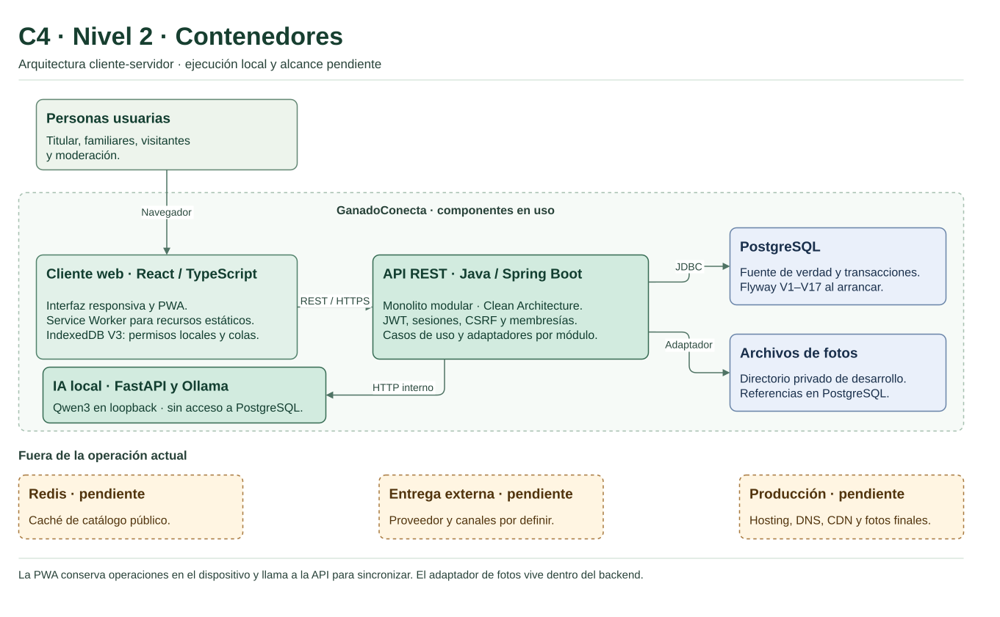

# Arquitectura inicial de GanadoConecta

## 1. Objetivo

Establecer la organización inicial del Sistema Inteligente para
la Gestión Integral de la Actividad Ganadera, denominado GanadoConecta.

La propuesta integra la gestión del ganado, los anuncios de venta
y el análisis inteligente, considerando los requisitos, atributos
de calidad y restricciones definidos.

## 2. Organización general

GanadoConecta utiliza una arquitectura cliente-servidor con
un backend monolítico modular organizado mediante Clean Architecture.

La aplicación web, el backend principal y PostgreSQL funcionan en el
entorno local. El análisis inteligente se prevé como servicio propio
independiente.

La solución incorporará Redis como caché del catálogo público.
PostgreSQL seguirá siendo la fuente principal de información
y conservará los datos permanentes.

## 3. Elementos principales

| Elemento | Tecnología | Responsabilidad |
|---|---|---|
| Aplicación web | React, TypeScript y PWA | Interfaz responsiva en español y «Mi ganado». IndexedDB conserva contexto local y operaciones pendientes en los flujos habilitados. |
| Backend principal | Java y Spring Boot | Exponer la API REST, verificar permisos, ejecutar casos de uso y coordinar las operaciones. |
| Base de datos | PostgreSQL, JDBC y Flyway | Conserva los registros del sistema. Las migraciones V1–V16 reproducen el esquema actual. |
| Caché | Redis · pendiente | Guardará resultados públicos del catálogo. Hoy las consultas llegan a PostgreSQL. |
| Servicio propio de IA | Python y FastAPI · pendiente | Analizará registros históricos y ofrecerá orientación con fuentes. |
| Almacenamiento de fotografías | Adaptador a directorio privado en desarrollo | Conserva archivos de imagen con referencias en PostgreSQL. El proveedor definitivo está pendiente. |
| Proveedor externo de notificaciones | Pendiente | Entregará avisos por canales por definir. La agenda ya muestra recordatorios internos. |

El diseño previsto sitúa el servicio de IA dentro de GanadoConecta y al
proveedor de notificaciones en su entorno externo.

### Diagrama general de la arquitectura

[C4 y fuente editable](../04-modelo-c4/Nivel2-DiagramaContenedores.md) ·
[Figura histórica de arquitectura general](../../img/historico/Figura_1_Estilo_GanadoConecta.png) ·
[Despliegue local y sincronización](diagramas/README.md)

Las integraciones futuras y responsabilidades lógicas de las secciones
siguientes documentan el diseño previsto. Los cinco paquetes de la API en
ejecución se identifican en el [C4 nivel 3](../04-modelo-c4/Nivel3-DiagramaComponentes.md).

## 4. Módulos del backend

| Módulo | Responsabilidad | Requisitos relacionados |
|---|---|---|
| Usuarios y acceso | Cuentas individuales, ganaderías, acceso familiar autorizado y administración de usuarios. | RF01, RF11, RF21 |
| Animales | Registro flexible individual/masivo, identificación única, categorías, nacimientos y genealogía. | RF02, RF05, RF18, RF20 |
| Seguimiento ganadero | Historial, controles individuales y campañas colectivas con asociación por animal. | RF03–RF06, RF22 |
| Calendario y alertas | Actividades programadas, recordatorios y alertas de seguimiento. | RF07, RF09 |
| Análisis inteligente | Análisis y conversación sobre datos autorizados y orientación general con fuentes; sin diagnosticar ni prescribir. | RF08, RF09, RF19 |
| Reportes | Consulta de reportes sanitarios, reproductivos y productivos y estadísticas básicas autorizadas. | RF10, RF11 |
| Anuncios | Publicación, búsqueda, estados, contacto autorizado, reportes y moderación. | RF12–RF16 |

El registro de una venta coordinará el estado del animal
y el cierre de sus anuncios activos dentro de una transacción.

Los módulos compartirán una aplicación desplegable y una base de datos,
manteniendo límites explícitos en el código. El acceso a funciones
de otro módulo se realizará mediante contratos definidos.

## 5. Organización interna

Las responsabilidades del backend se distribuirán en:

- **Dominio:** entidades y reglas de negocio.
- **Aplicación:** casos de uso y contratos necesarios.
- **Adaptadores de interfaz:** controladores REST, DTO y transformaciones.
- **Infraestructura:** persistencia, clientes de servicios,
  almacenamiento y configuración tecnológica.

Las dependencias del código apuntarán hacia el núcleo.
El dominio no dependerá de Spring Boot, PostgreSQL ni FastAPI.

## 6. Comunicación y ejecución

1. El usuario realiza una operación desde la aplicación web.
2. React envía la solicitud a la API REST mediante HTTPS y JSON.
3. El backend valida el formato, la identidad y los permisos
   cuando la operación está protegida.
4. El caso de uso aplica las reglas y utiliza los contratos necesarios.
5. Los adaptadores ejecutan el acceso a datos o las integraciones.
6. El backend devuelve la respuesta a la aplicación web.

Las solicitudes de análisis y notificaciones se registrarán como
tareas persistentes y se procesarán en segundo plano.

La creación de una tarea asociada a un cambio de negocio deberá
ser consistente con ese cambio. Cuando ambos se almacenen
en PostgreSQL, se utilizará la misma transacción.

Una falla temporal de IA o notificaciones no deberá impedir
el registro de animales ni la consulta de historiales y anuncios.

### Consulta del catálogo con caché

1. La aplicación web solicita una consulta del catálogo.
2. El backend consulta Redis mediante el contrato de caché.
3. Si existe una entrada vigente, utiliza el resultado almacenado.
4. Si la entrada no existe, ha caducado o Redis no está disponible,
   consulta PostgreSQL.
5. Cuando Redis está disponible, puede almacenar el resultado
   obtenido con un tiempo de caducidad.
6. El backend devuelve únicamente información pública autorizada.

Las claves de caché distinguirán los filtros, la paginación
y el orden de los resultados.

Después de confirmar en PostgreSQL cambios de publicación,
edición, pausa, retirada, moderación o venta, se invalidarán
las entradas afectadas. Las invalidaciones fallidas se registrarán
y reintentarán.

La especificación del catálogo definirá el tiempo de caducidad,
la estrategia de invalidación y las medidas para impedir
que se exponga información que haya dejado de estar autorizada.

## 7. Seguridad e integridad

- Se verificará la pertenencia de los registros en las operaciones
  protegidas, además de comprobar el rol del usuario.
- El catálogo público utilizará respuestas específicas con
  información autorizada.
- Los historiales completos permanecerán privados.
- La venta conservará el historial del animal.
- Las tareas incorporarán estados, intentos y controles
  para su recuperación y para reducir duplicados.
- Redis almacenará únicamente resultados públicos del catálogo.
  No contendrá historiales privados, credenciales ni archivos
  de fotografías.
- Las operaciones de modificación comprobarán el estado vigente
  en PostgreSQL.
- Redis no formará parte de la transacción de venta.
  La invalidación se realizará después de confirmar
  la actualización del animal y el cierre de sus anuncios.

## 8. Desarrollo y verificación

El desarrollo se guiará mediante SDD. Las especificaciones
de cada funcionalidad se documentarán en specs/ antes
de implementar su código.

Se realizarán pruebas unitarias, de integración y de carga.
El objetivo inicial de rendimiento será un percentil 95
de hasta 2 segundos para consultas de animales y anuncios
con 100 usuarios concurrentes, bajo condiciones documentadas.

Las pruebas de integración comprobarán aciertos y ausencias
de caché, caducidad, invalidación y recuperación ante fallos.

Las pruebas de carga distinguirán caché vacía y poblada.
También se evaluará la continuidad de las consultas cuando
Redis no esté disponible, registrando la degradación observada.

## 9. Límites y evolución

La primera versión no procesará pagos, cobrará comisiones
ni gestionará transporte o chat interno.

La IA no realizará diagnósticos veterinarios.

Redis forma parte de la arquitectura de la primera versión.
Su configuración se ajustará según las mediciones de rendimiento.

La separación de nuevos servicios se evaluará según
las necesidades de crecimiento del sistema.

## 10. Extensión aprobada para PWA y colaboración

Las decisiones ADR-12–ADR-15 complementan la arquitectura original.
El cliente mantiene IndexedDB y una cola local; estos datos no sustituyen
PostgreSQL. La interfaz distingue pendiente, sincronizado, conflicto y error.
La API recibe operaciones de RF17 y delega en los mismos casos de uso del
monolito, verificando identidad, membresía, permisos, versión y duplicados.
La identidad se obtiene de la autenticación, no de un actor declarado por el cliente.
No se incorporan servicios independientes para sincronización o fotografías.
Los recordatorios individuales y colectivos siguen en Calendario, sin IA.

Nacimientos/parentescos pertenecen a Animales y colaboran con los eventos
reproductivos de Seguimiento. La venta no transfiere fichas ni historiales.
La genealogía pública es una proyección autorizada, separada del historial.
El formato concreto de claves, lotes, contratos y conflictos se definirá en SPEC.

La figura PNG es la vista original; su actualización gráfica está pendiente
por ausencia de fuente editable. Las relaciones vigentes están descritas en
los [documentos C4](../04-modelo-c4/Nivel2-DiagramaContenedores.md).
