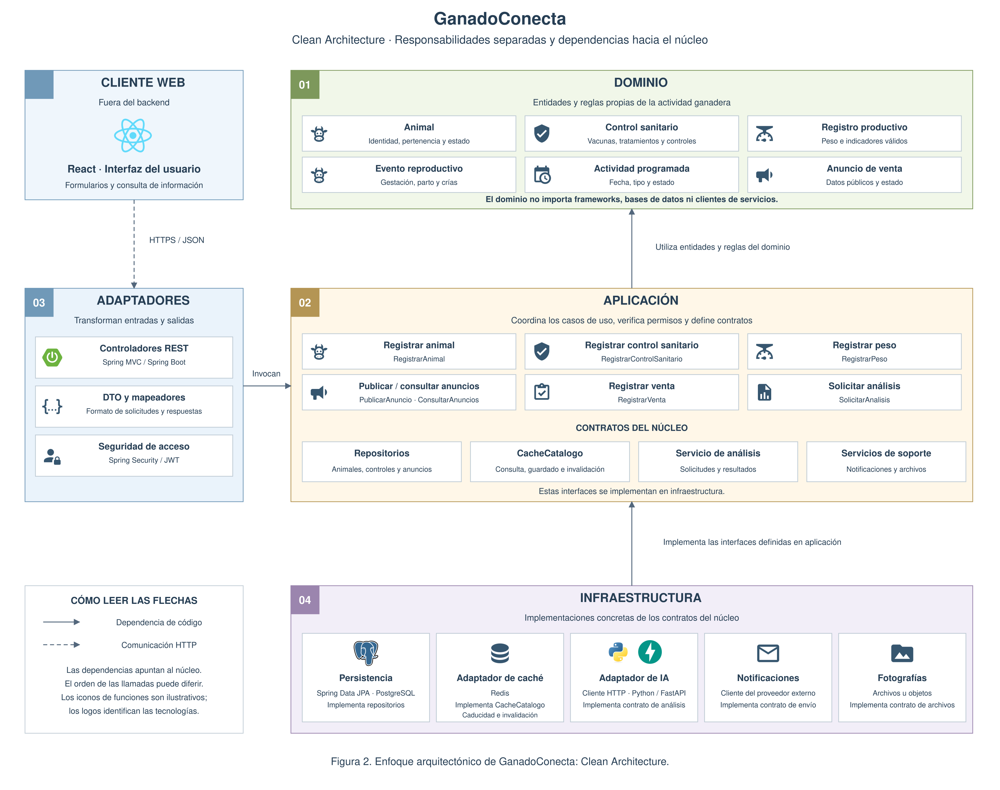

# Enfoque arquitectónico: Clean Architecture

## 1. Enfoque seleccionado

GanadoConecta aplicará Clean Architecture para organizar
las responsabilidades y dependencias internas del backend.

El objetivo es mantener las reglas del negocio y los casos de uso
separados de los detalles de interfaz, persistencia, caché
e integración con servicios.

Este enfoque complementa al monolito modular:
los módulos delimitan funcionalidades y Clean Architecture
organiza sus responsabilidades internas.

## 2. Distribución de responsabilidades

| Parte | Responsabilidad | Ejemplos en GanadoConecta |
|---|---|---|
| Dominio | Representar entidades y reglas fundamentales del negocio. | Animal, control sanitario, registro de peso, evento reproductivo y anuncio. |
| Aplicación | Coordinar casos de uso y definir los contratos que necesitan. | RegistrarAnimal, RegistrarPeso, PublicarAnuncio, ConsultarAnuncios, RegistrarVenta y SolicitarAnalisis. |
| Adaptadores de interfaz | Transformar solicitudes y respuestas entre los formatos externos y los modelos internos. | Controladores REST, DTO y respuestas públicas del catálogo. |
| Infraestructura | Implementar persistencia, caché, comunicación y configuración tecnológica. | Spring Data JPA, PostgreSQL, cliente Redis, cliente FastAPI, notificaciones y almacenamiento de fotografías. |

La aplicación web React es un cliente de la API.
No forma parte del núcleo del backend.

## 3. Regla de dependencia

Las dependencias del código apuntarán hacia el núcleo:

- El dominio no dependerá de Spring Boot, PostgreSQL, Redis
  ni clientes HTTP.
- La aplicación utilizará el dominio y definirá contratos
  para los recursos que necesite.
- Los controladores REST invocarán los casos de uso.
- Los adaptadores de infraestructura implementarán
  los contratos del núcleo.
- La configuración de Spring Boot conectará los casos de uso
  con sus implementaciones mediante inyección de dependencias.

Las llamadas durante la ejecución pueden ir desde un caso de uso
hacia un adaptador. Esto no cambia la regla de dependencia:
el caso de uso conocerá el contrato y no la implementación concreta.

### Diagrama del enfoque arquitectónico

*Figura 2. Clean Architecture de GanadoConecta, con Redis
integrado mediante un contrato del núcleo y un adaptador.*

## 4. Contratos y adaptadores

Los siguientes nombres son orientativos. Se precisarán
en las especificaciones antes de implementar.

| Contrato | Finalidad | Implementación prevista |
|---|---|---|
| RepositorioAnimales | Consultar y conservar animales. | Adaptador de persistencia con Spring Data JPA. |
| RepositorioAnuncios | Consultar y conservar anuncios. | Adaptador de persistencia con Spring Data JPA. |
| CacheCatalogo | Consultar, guardar e invalidar resultados públicos. | Adaptador Redis. |
| ServicioAnalisis | Solicitar análisis de registros históricos. | Adaptador HTTP del servicio Python/FastAPI. |
| ServicioNotificaciones | Solicitar el envío de avisos. | Adaptador del proveedor externo. |
| AlmacenamientoFotografias | Guardar y recuperar archivos de imagen. | Adaptador de almacenamiento de archivos u objetos. |
| RepositorioTareas | Conservar tareas, estados e intentos. | Adaptador de persistencia en PostgreSQL. |

Los contratos expresarán las necesidades de los casos de uso
sin exponer tipos específicos de Redis, JPA o clientes HTTP.

No se creará una interfaz para cada clase.
La separación se aplicará donde permita aislar dependencias
y probar comportamientos relevantes.

## 5. Reglas de negocio y acceso

| Funcionalidad | Regla |
|---|---|
| Registro de controles | Todo control deberá estar asociado a un animal existente. |
| Registro de peso | El peso deberá ser mayor que cero. |
| Gestión de registros | El productor solo podrá gestionar animales bajo su responsabilidad. |
| Publicación | El productor deberá ser responsable del animal y completar los datos obligatorios. |
| Consulta pública | Solo se mostrarán anuncios publicados y habilitados por moderación, con información autorizada. |
| Venta | Se actualizará el animal como vendido y se cerrarán sus anuncios activos, conservando el historial. |

Las reglas propias de las entidades se ubicarán en el dominio.
La coordinación de permisos, consultas y operaciones se realizará
en los casos de uso.

## 6. Ejemplo: publicar un anuncio

1. El productor completa el formulario en React.
2. El controlador REST recibe y valida el formato de la solicitud.
3. El caso de uso PublicarAnuncio verifica identidad, permisos
   y pertenencia del animal.
4. Se comprueban el estado del animal y los datos del anuncio.
5. El anuncio se guarda mediante el contrato de repositorio.
6. Se confirma la operación en PostgreSQL.
7. Se solicita la invalidación de la caché afectada.
8. El controlador devuelve la respuesta.

Si la invalidación falla, se registrará para reintentarla.
El fallo de Redis no deshará una publicación ya confirmada.

La especificación definirá cómo evitar que resultados antiguos
expongan información que haya dejado de estar autorizada.

## 7. Ejemplo: consultar el catálogo

El caso de uso ConsultarAnuncios utilizará el contrato CacheCatalogo.

Si existe un resultado vigente, podrá utilizarlo. Si no existe,
ha caducado o Redis falla, consultará el repositorio de anuncios.

Cuando Redis esté disponible, podrá guardar el resultado público
con un tiempo de caducidad.

Las claves distinguirán filtros, paginación y orden.
La caché no almacenará historiales privados, credenciales
ni archivos de fotografías.

## 8. Transacciones y tareas

RegistrarVenta coordinará la actualización del animal
y el cierre de sus anuncios dentro de una misma transacción
de PostgreSQL.

La aplicación definirá el alcance de la operación y la infraestructura
proporcionará el mecanismo transaccional, manteniendo el dominio
independiente de la tecnología.

Redis no participará en esa transacción.
La invalidación se realizará después de confirmar el cambio.

Los análisis de IA y las notificaciones se ejecutarán mediante
tareas persistentes. Su procesamiento utilizará los casos de uso
y los contratos de integración correspondientes.

## 9. Relación con SDD

Las especificaciones de specs/ definirán, antes de implementar:

- Casos de uso y reglas de negocio.
- Entradas, resultados y errores.
- Permisos y pertenencia.
- Contratos necesarios.
- Límites transaccionales.
- Comportamiento de la caché y las tareas.
- Criterios de aceptación y pruebas.

SDD guiará el desarrollo y mantendrá la trazabilidad.
Clean Architecture organizará el código resultante.

## 10. Verificación

- Pruebas unitarias del dominio y los casos de uso
  con implementaciones simuladas de los contratos.
- Pruebas de integración de controladores, persistencia,
  seguridad, caché y servicios.
- Pruebas de carga de las consultas de animales y anuncios.
- Revisión de dependencias para comprobar que el núcleo
  no dependa de implementaciones de infraestructura.

La separación permitirá probar reglas de negocio sin ejecutar
PostgreSQL, Redis o el servicio real de IA.