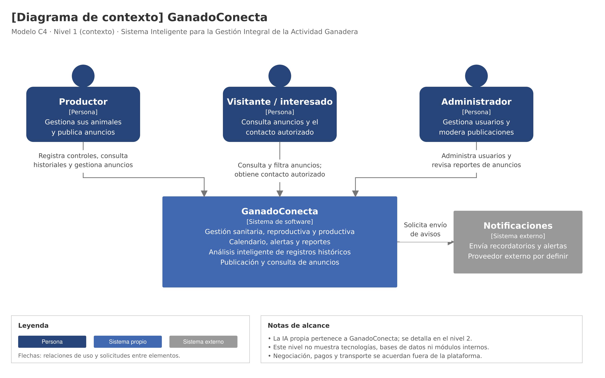

# Modelo C4 — Nivel 1: Contexto

## 1. Objetivo

Mostrar GanadoConecta como un sistema completo, identificando
las personas que lo utilizan y el sistema externo con el que
se comunica.

## 2. Sistema

GanadoConecta permite gestionar ganado vacuno, mantener
historiales sanitarios, reproductivos y productivos,
programar actividades, consultar reportes, analizar registros
y publicar anuncios de animales en venta.

## 3. Actores

| Actor | Relación con GanadoConecta |
|---|---|
| Productor | Gestiona sus animales, registra controles, consulta información y administra sus anuncios. |
| Visitante o interesado | Consulta y filtra anuncios públicos y obtiene el contacto autorizado del vendedor. |
| Administrador | Gestiona usuarios y revisa reportes de publicaciones para moderar el catálogo. |

## 4. Sistema externo

| Sistema | Responsabilidad |
|---|---|
| Proveedor de notificaciones | Enviar recordatorios y alertas solicitados por GanadoConecta. |

El proveedor concreto y los canales de envío están
pendientes de selección.

## 5. Diagrama

*Figura. Modelo C4 de nivel 1: contexto de GanadoConecta.*

## 6. Interpretación

Las flechas muestran cómo los actores utilizan GanadoConecta
y cómo el sistema solicita el envío de notificaciones.

El servicio propio de IA forma parte de GanadoConecta,
aunque se ejecute de manera independiente.

React, el backend, PostgreSQL, Redis y el almacenamiento
de fotografías se detallan en el nivel 2.

## 7. Límites del alcance

- Los historiales completos permanecen privados.
- Los anuncios muestran únicamente información autorizada.
- La negociación, los pagos y el transporte se realizan
  fuera de la plataforma.
- La IA no realiza diagnósticos ni sustituye
  la evaluación veterinaria.