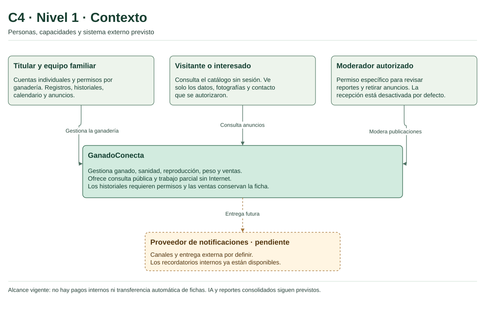

# Modelo C4 — Nivel 1: Contexto

GanadoConecta reúne la gestión de ganado vacuno, sus historiales, el calendario y el catálogo. Esta vista distingue a las personas usuarias del proveedor externo previsto.

[Fuente Draw.io, página 1](diagramas/ganadoconecta-c4.drawio) · [Figura histórica](../../img/historico/GanadoConecta_C4_Nivel_1_Contexto.png)

| Actor o sistema | Alcance |
|---|---|
| ACT01 · Titular y equipo familiar | Cuentas individuales, permisos por ganadería, registros e historiales privados. El alcance sin conexión es parcial. |
| ACT02 · Visitante o interesado | Consulta el catálogo público y ve los datos, las fotografías, el contacto y la genealogía que se hayan autorizado. |
| ACT03 · Moderador autorizado | Revisa reportes con permiso específico y puede retirar publicaciones. La recepción de reportes está desactivada por defecto. La gestión administrativa general de cuentas queda pendiente. |
| EXT01 · Proveedor de notificaciones | Entrega externa pendiente. La agenda ya muestra recordatorios internos para hoy y actividades vencidas. |

Registrar una venta conserva la ficha y cierra los anuncios activos. La negociación, el pago y el transporte ocurren fuera del sistema. La IA para análisis y orientación con fuentes forma parte del alcance previsto, con los límites documentados para diagnóstico y prescripción.

**Trazabilidad.** [Actores](../01-analisis-de-sistema/01-actores.md), [matriz RF/HU](../MATRIZ-DE-TRAZABILIDAD.md), [hoja de ruta](../HOJA-DE-RUTA.md) y [nivel 2](Nivel2-DiagramaContenedores.md).
