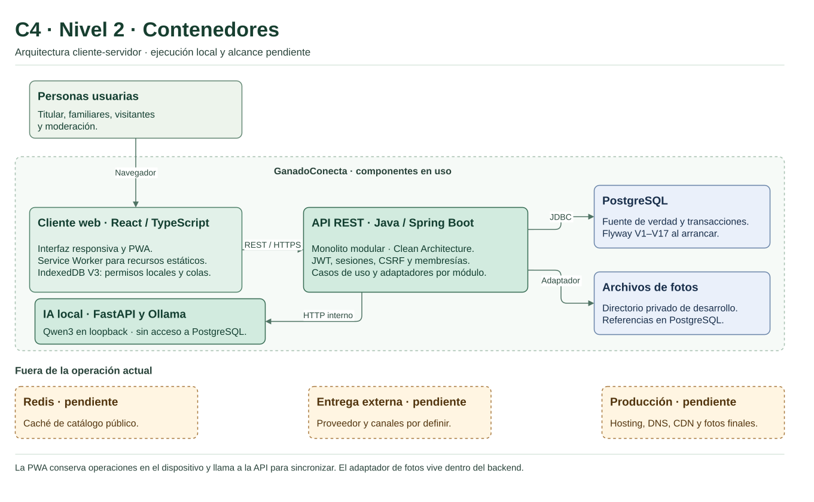

# Modelo C4 — Nivel 2: Contenedores

Un contenedor C4 representa una aplicación o un almacén. El esquema separa las piezas de la ejecución local de las integraciones previstas.

[Fuente Draw.io, página 2](diagramas/ganadoconecta-c4.drawio) · [Figura histórica](../../img/historico/GanadoConecta_C4_Nivel_2_Contenedores.png)

| Contenedor o recurso | Responsabilidad vigente |
|---|---|
| Aplicación web · React y TypeScript | Interfaz responsiva en español. El Service Worker precacha recursos estáticos. IndexedDB V3 conserva contexto local y operaciones pendientes para los flujos habilitados. |
| API · Java y Spring Boot | Monolito modular con Clean Architecture, seguridad y autorización. Atiende las operaciones online y las que el cliente reenvía al recuperar la conexión. |
| PostgreSQL 17 · JDBC y Flyway | Fuente de verdad para los registros, transacciones y comprobantes de idempotencia. El esquema actual se reproduce con V1–V17. |
| Directorio privado de fotos | Almacenamiento local de desarrollo detrás del adaptador del catálogo. PostgreSQL conserva referencias y metadatos. |
| Python · FastAPI y Ollama local | Recibe hechos autorizados desde Spring por loopback y selecciona referencias mediante Qwen3. Spring valida y presenta el resultado. FastAPI carece de acceso directo a PostgreSQL. |

El cliente usa REST/HTTPS y JSON. Las fotografías se envían como archivos binarios y se consultan mediante rutas del catálogo. El alcance sin conexión cubre el alta individual y determinados eventos sanitarios, con revalidación de sesión y permisos al sincronizar. Las consultas privadas de la API requieren conexión.

**Previsto.** Redis para resultados públicos del catálogo con caducidad e invalidación, entrega externa de notificaciones, almacenamiento definitivo de fotografías y despliegue de producción con DNS y CDN. Las consultas públicas llegan hoy a PostgreSQL.

**Trazabilidad.** [Decisiones arquitectónicas](../01-analisis-de-sistema/07-decisiones-arquitectonicas.md), [contratos SDD](../../specs/README.md), [despliegue local](../02-arquitectura-software/diagramas/despliegue-local.svg), [sincronización](../02-arquitectura-software/diagramas/sincronizacion-offline.svg) y [nivel 3](Nivel3-DiagramaComponentes.md).
