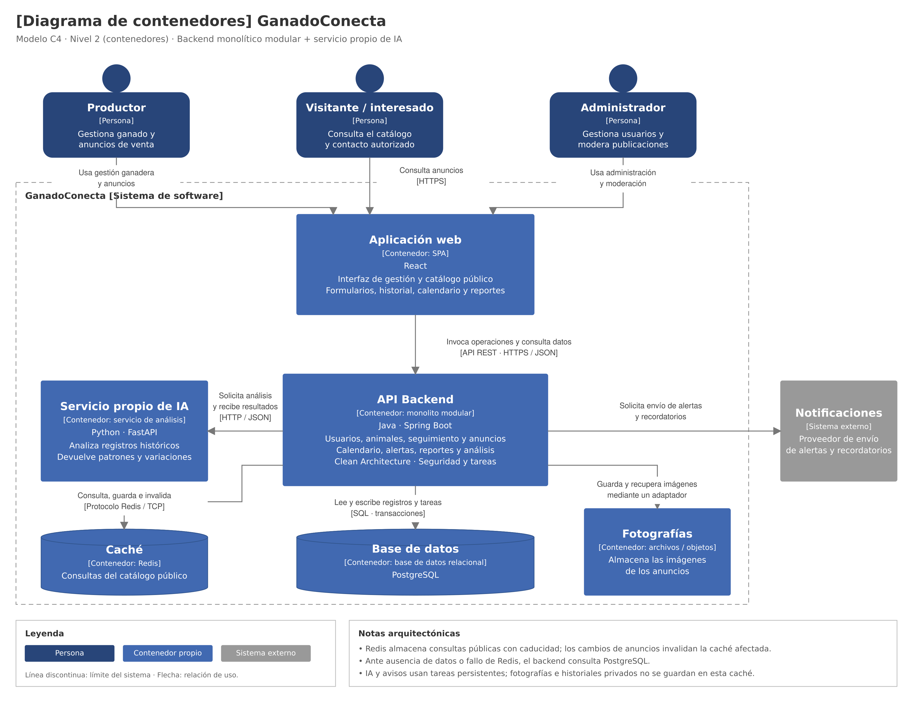

# Modelo C4 — Nivel 2: Contenedores

## 1. Objetivo

Mostrar las aplicaciones y los almacenamientos que forman
GanadoConecta, sus responsabilidades y sus relaciones.

En C4, un contenedor representa una aplicación o un almacenamiento.
No significa necesariamente un contenedor Docker.

## 2. Contenedores del sistema

| Contenedor | Tecnología | Responsabilidad |
|---|---|---|
| Aplicación web | React | Presentar las interfaces de gestión, administración y catálogo público. |
| API Backend | Java y Spring Boot | Ejecutar los casos de uso, comprobar permisos y coordinar las operaciones del sistema. |
| Base de datos | PostgreSQL | Conservar los registros permanentes, sus relaciones y las tareas persistentes. |
| Caché | Redis | Guardar temporalmente resultados de consultas frecuentes del catálogo público. |
| Servicio propio de IA | Python y FastAPI | Analizar registros históricos y devolver patrones o variaciones productivas. |
| Almacenamiento de fotografías | Archivos u objetos | Conservar las imágenes de los anuncios. |

La solución concreta de almacenamiento de fotografías
está pendiente de selección.

## 3. Sistema externo

El proveedor de notificaciones enviará recordatorios y alertas
solicitados por el backend.

Se representa fuera del límite de GanadoConecta porque
es un servicio externo. Su proveedor y canales están
pendientes de selección.

## 4. Diagrama

*Figura. Modelo C4 de nivel 2: contenedores de GanadoConecta.*

[Consultar editable en Draw.io](../../img/GanadoConecta_C4_Nivel_2_Contenedores.drawio)

## 5. Relaciones principales

| Origen | Destino | Interacción |
|---|---|---|
| Productor, visitante y administrador | Aplicación web | Utilizan las funcionalidades correspondientes a sus permisos. |
| Aplicación web | API Backend | Invoca operaciones mediante API REST sobre HTTPS y JSON. |
| API Backend | PostgreSQL | Lee y escribe registros mediante operaciones SQL y transacciones. |
| API Backend | Redis | Consulta, guarda e invalida resultados del catálogo mediante el protocolo Redis sobre TCP. |
| API Backend | Servicio propio de IA | Solicita análisis y recibe resultados mediante HTTP y JSON. |
| API Backend | Proveedor de notificaciones | Solicita el envío de recordatorios y alertas. |
| API Backend | Almacenamiento de fotografías | Guarda y recupera imágenes mediante un adaptador. |

Los mecanismos concretos de integración con notificaciones
y almacenamiento se definirán al seleccionar sus soluciones.

## 6. Uso de la caché

PostgreSQL será la fuente principal de información.

El backend consultará Redis para obtener resultados públicos
del catálogo. Si la entrada no existe, ha caducado o Redis falla,
consultará PostgreSQL.

Los resultados tendrán caducidad. Después de confirmar cambios
en anuncios, se invalidarán las entradas afectadas.

La especificación definirá cómo controlar resultados
desactualizados y evitar la exposición de información
que haya dejado de estar autorizada.

## 7. Procesamiento independiente

El backend principal será una aplicación monolítica modular.
Sus módulos compartirán una unidad de despliegue.

El servicio de IA se ejecutará de manera independiente.
Las solicitudes de análisis y notificaciones se gestionarán
mediante tareas persistentes en segundo plano dentro del backend.

## 8. Seguridad y datos

- El backend verificará identidad, permisos y pertenencia.
- Los historiales completos permanecerán privados.
- Redis almacenará únicamente resultados públicos del catálogo.
- Las fotografías se conservarán como archivos; PostgreSQL
  mantendrá sus referencias y metadatos.
- Las integraciones recibirán únicamente los datos necesarios.

## 9. Relación con el siguiente nivel

El nivel 3 detallará los componentes internos de la API Backend:
controladores, módulos, ejecutor de tareas y adaptadores.