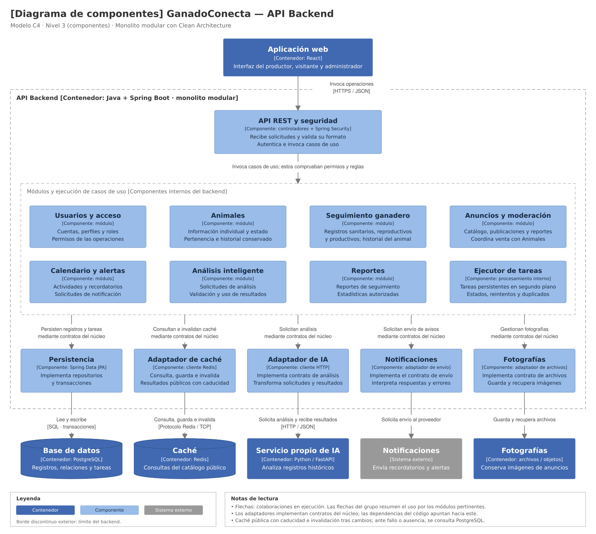

# Modelo C4 — Nivel 3: Componentes

## 1. Objetivo

Detallar los componentes internos de la API Backend
de GanadoConecta, sus responsabilidades y sus colaboraciones
con los demás contenedores y servicios.

El alcance de este diagrama es el backend principal
desarrollado con Java y Spring Boot.

## 2. Organización del backend

El backend será un monolito modular organizado mediante
Clean Architecture.

Sus componentes compartirán una aplicación desplegable.
La separación de responsabilidades permitirá mantener
las reglas de negocio independientes de la infraestructura.

## 3. Componentes principales

| Componente | Responsabilidad |
|---|---|
| API REST y seguridad | Recibir solicitudes, validar su formato, autenticar e invocar casos de uso. |
| Usuarios y acceso | Gestionar cuentas, perfiles, roles y permisos. |
| Animales | Gestionar información individual, pertenencia y estado de los animales. |
| Seguimiento ganadero | Gestionar registros e historiales sanitarios, reproductivos y productivos. |
| Anuncios y moderación | Gestionar publicaciones, catálogo, estados y reportes de anuncios. |
| Calendario y alertas | Gestionar actividades, recordatorios y alertas. |
| Análisis inteligente | Preparar solicitudes y gestionar resultados de análisis. |
| Reportes | Consultar información consolidada y estadísticas autorizadas. |
| Ejecutor de tareas | Procesar tareas persistentes, registrar estados y aplicar reintentos. |

## 4. Adaptadores de infraestructura

| Adaptador | Responsabilidad | Destino |
|---|---|---|
| Persistencia | Implementar repositorios y operaciones transaccionales. | PostgreSQL |
| Caché | Consultar, almacenar e invalidar resultados públicos con caducidad. | Redis |
| IA | Transformar solicitudes y resultados del análisis. | Servicio Python/FastAPI |
| Notificaciones | Solicitar envíos e interpretar respuestas y errores. | Proveedor externo |
| Fotografías | Guardar y recuperar archivos de imagen. | Almacenamiento de archivos u objetos |

Los adaptadores implementarán contratos definidos en el núcleo.
Los casos de uso no dependerán directamente de sus tecnologías.

## 5. Diagrama

*Figura. Modelo C4 de nivel 3: componentes de la API Backend.*

## 6. Lectura de las relaciones

La aplicación web consume la API REST mediante HTTPS y JSON.

Los controladores invocan los casos de uso, que comprueban
los permisos, la pertenencia de los registros y las reglas
correspondientes.

Las flechas que parten del grupo de módulos resumen
las colaboraciones con los adaptadores. No significan
que todos los módulos utilicen todos los adaptadores.

Las flechas representan colaboraciones durante la ejecución.
Las dependencias del código apuntarán hacia el núcleo
según Clean Architecture.

## 7. Operaciones relevantes

### Consulta del catálogo

El backend utiliza el contrato de caché para consultar Redis.
Cuando no existe una entrada vigente o Redis falla,
obtiene los datos desde PostgreSQL.

Los cambios confirmados en anuncios invalidan las entradas
afectadas. Las invalidaciones fallidas se registran
y reintentan.

La especificación definirá cómo impedir la exposición
de información que haya dejado de estar autorizada.

### Registro de venta

La actualización del animal y el cierre de sus anuncios activos
se ejecutan dentro de una misma transacción de PostgreSQL.

El historial se conserva. Después de confirmar el cambio,
se invalida la caché afectada.

### Análisis y notificaciones

El ejecutor procesa las tareas persistentes y utiliza
los adaptadores correspondientes.

Se controlan estados, intentos y recuperación ante fallos,
con mecanismos para reducir resultados o envíos duplicados.

## 8. Verificación

- Pruebas unitarias de reglas y casos de uso.
- Pruebas de integración de API, permisos y pertenencia.
- Pruebas de persistencia, transacciones y tareas.
- Pruebas de caducidad, invalidación y fallos de Redis.
- Pruebas de integración de IA y notificaciones.
- Pruebas de carga de consultas de animales y anuncios.

## 9. Estado

El diagrama representa la arquitectura propuesta.
La implementación y las pruebas están pendientes.

El nivel 4 se elaborará cuando se concrete el diseño
de código de un componente seleccionado.