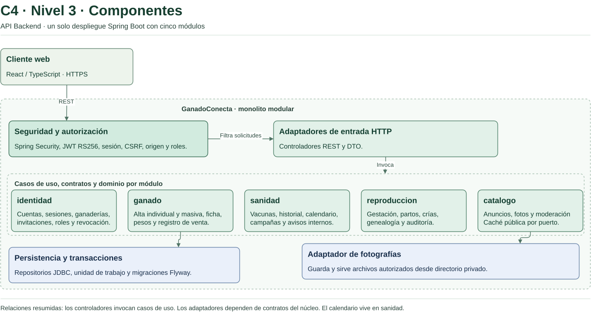

# Modelo C4 — Nivel 3: Componentes

La API Spring Boot se despliega como un monolito modular. La figura resume los módulos principales y sus adaptadores.

[Fuente Draw.io, página 3](diagramas/ganadoconecta-c4.drawio) · [Figura histórica](../../img/historico/GanadoConecta_C4_Nivel_3_Componentes.png)

| Componente | Responsabilidad y contratos |
|---|---|
| Adaptadores HTTP y seguridad | Controladores REST, validación, Argon2id en autenticación, JWT RS256, sesión persistente, CSRF, origen y comprobación de membresía para las operaciones privadas. |
| `identidad` | Cuentas y sesiones, ganaderías, membresías, invitaciones y revocación. SPEC-01 y SPEC-04. |
| `ganado` | Alta individual y masiva, listado, ficha, historial de pesos y venta. SPEC-01, SPEC-05, SPEC-06 y SPEC-09. |
| `sanidad` | Vacunación e historial, calendario, recordatorios internos y campañas con atenciones confirmadas. SPEC-02 y SPEC-07. |
| `reproduccion` | Eventos reproductivos, gestación, partos, crías, genealogía y auditoría. SPEC-03. |
| `catalogo` | Anuncios y fotos, proyección pública autorizada, moderación y puerto de caché pública. `CacheCatalogoRedis` comprueba la revisión en PostgreSQL. SPEC-08 y SPEC-09. |

Los controladores delegan a los casos de uso. Los adaptadores JDBC y de archivos dependen de los contratos del núcleo. Las escrituras sincronizadas reutilizan los endpoints de ganado y sanidad y comprueban nuevamente la autorización dentro de la transacción. El registro de venta cambia el estado del animal y cierra sus anuncios activos de forma atómica.

Los módulos `reportes` y `analisis` ofrecen reportes, análisis descriptivo y
acceso al asistente local. El módulo `identidad` incluye consultas de administración.
Quedan pendientes la edición del perfil, las tareas diferidas de análisis y
las notificaciones externas.

**Trazabilidad.** [Diseño interno y modelo de datos](../03-diseno-de-software/diseño-interno-de-modulos.md), [ejemplo Clean Architecture](../02-arquitectura-software/diagramas/clean-architecture.svg), [contratos SDD](../../specs/README.md) y [evidencia E2E](../../tests/e2e/README.md).
