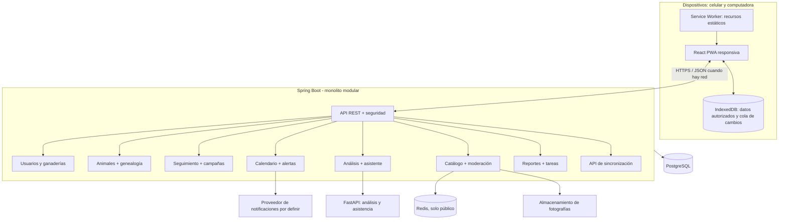

# Arquitectura técnica propuesta — GanadoConecta v2

## Línea base preservada

Arquitectura cliente-servidor; frontend React; backend Java/Spring Boot **monolito modular** con Clean Architecture; PostgreSQL como fuente principal; Redis para caché del catálogo público; FastAPI como servicio de IA independiente; contratos para notificaciones y archivos. Mantener API REST/HTTPS/JSON, pruebas y tareas persistentes que la documentación original ya define.

## Vista simplificada (propuesta textual, no sustituye imágenes C4)

**C4 nivel 2:** indicar almacenamiento local y Service Worker como partes internas del contenedor cliente PWA (o anotaciones asociadas), una relación de sincronización por API y el servicio externo de archivos, si lo presta un tercero. **C4 nivel 3 del backend:** ampliar Usuarios para membresías; Animales para genealogía; Seguimiento para campañas; Análisis para asistente; API para sincronización. Los PNG y fuentes editables originales no se modificaron en este paquete.

## Límites de responsabilidad

- **Usuarios y acceso:** cuentas, autenticación, ganaderías, invitaciones, membresías y autorización por recurso. El propietario controla los accesos de su ganadería.
- **Animales:** registros, categoría, nombre/apodo, aretes, nacimientos, ascendencia, estado (activo/vendido/fallecido). Cada animal tiene UUID técnico; nombre y texto de arete no son claves globales.
- **Seguimiento ganadero:** pesos, actividades sanitarias y productivas, campañas y aplicaciones individuales; historial inmutable/auditable en eventos sensibles.
- **Calendario y alertas:** recordatorios individuales o colectivos y su estado, reglas basadas en fechas confirmadas y sin dependencia del modelo de IA.
- **Análisis inteligente:** obtiene solo registros autorizados desde backend; consultas concretas calculadas mediante herramientas/consultas deterministas; resultados interpretables y auditables. FastAPI es servicio de apoyo, no una segunda base de datos del ganado.
- **Catálogo y moderación:** proyección pública **separada** de datos privados; genealogía únicamente autorizada; cerrar anuncio y venta transaccional. Cachear solo resultados públicos y revocar caché tras cambios.
- **Ejecución de tareas:** análisis diferidos, avisos y reintentos en PostgreSQL según ADR-09. No duplicar estos trabajos en el sincronizador.
- **Imágenes:** un adaptador del backend gestiona carga/recuperación en el proveedor escogido. PostgreSQL almacena metadata y referencias.

## Offline-First: contrato mínimo

1. React tiene repositorio local (IndexedDB) para **subconjunto autorizado**: animales, registros sanitarios y pesos, calendario, categorías y cola de operaciones.
2. Service Worker precachea archivos de la aplicación; **no** cachea respuestas HTTP privadas de usuarios indiscriminadamente.
3. Operación offline = `operationId` UUID + `ganaderiaId` + `actorId` + `tipo` + `entidadId` UUID + `baseVersion` + marca local + datos mínimos.
4. Sincronizar al iniciar sesión y cuando vuelve la conexión, así como con botón «Sincronizar ahora». No depender solo de Background Sync, cuyo soporte es limitado.
5. El servidor valida JWT vigente, membresía, permiso, versión y esquema. Deduplica `operationId`. Devuelve por operación `aplicado | rechazado | conflicto` con motivo seguro y versión actual.
6. En conflicto, conservar la operación local, avisar y permitir revisión. No sobrescribir silenciosamente y no asumir que todos los cambios son fusionables.
7. Para nuevas anotaciones de peso/control, preferir eventos agregados independientes con UUID, no sobreescritura del mismo registro; también deben respetar validaciones.
8. Enviar sincronización solo por HTTPS. No almacenar contraseñas en IndexedDB ni imágenes privadas en la caché pública. Definir política de cierre de sesión, borrado local y advertencias para dispositivos compartidos.
9. Si se pierde el almacenamiento del navegador antes de sincronizar, los datos locales pueden perderse. Mostrar siempre «Guardado en este dispositivo», «Pendiente», «Sincronizado» o «Error».
10. Si una venta se registra offline, **no ocultar el anuncio públicamente hasta que el servidor confirme la operación**; mostrar advertencia de venta pendiente.

## IA: dos productos, una frontera segura

**Análisis inteligente (RF08):** métricas generales, cambios de peso y resumen de campañas a partir de consultas deterministas y datos históricos, con fecha de corte, calidad de datos, fuente y advertencias de limitaciones. No inferir enfermedades a partir de fotos o de un solo dato.

**Asistente (RF19 propuesto):**
- Modo «Mis animales»: el backend traduce solicitudes autorizadas en herramientas de solo lectura con filtros forzosos por ganadería/membresía. Los totales y fechas se calculan en la base de datos, no mediante alucinaciones del modelo.
- Modo «Información ganadera general»: corpus de documentos curados por responsable, con identificación de entidad, fecha y referencia verificable (ej. documentos de SENASA, FAO u organismos técnicos relevantes). Si no hay fuente suficiente, indicar que no se puede verificar.
- Responder en español, señalar fuente/fecha del dato y limitar conclusiones clínicas. No prescribir dosis ni esquemas; derivar consultas clínicas a veterinario.
- No acceder a registros de otra ganadería ni revelar historiales privados en salidas públicas. Evaluar proveedor de modelo, seguridad, costos, consentimientos y retención de datos antes de implementarlo.
- Servicio temporalmente caído: el registro de ganado, calendario y controles continúa funcionando.

## Seguridad y persistencia

- En backend, autorización por pertenencia a ganadería + rol **en cada caso de uso**, no solo en el frontend.
- Auditoría de altas, ediciones, campañas y ventas (`actorId`, entidad, instante servidor, cambio); definir retención.
- PostgreSQL con claves foráneas, índices por `ganaderiaId`, `animalId`, estado y fecha; transacciones para venta/anuncios.
- La proyección pública del anuncio se genera por lista explícita de campos; el campo `mostrarGenealogia` se inicia en `false`.
- Redis se considera descartable; si falla, obtener datos autorizados de PostgreSQL. Prevenir exposición persistente tras revocar publicación.

## Disponibilidad de notificaciones

Las actividades pendientes se muestran en la aplicación aun sin señal si fueron descargadas. **No se garantiza** una alerta a hora exacta con el navegador cerrado y sin internet. Mensajería fuera de la plataforma requiere un proveedor que se elegirá en otra fase.

## Aspectos aún por verificar en etapa técnica, sin bloquear el inicio

Versión LTS de Java/Spring Boot y Node, librería UI, proveedor de fotografías, proveedor/corpus/modelo de IA, proveedor de notificaciones, hospedaje, dominio, copias de seguridad y reglas de retención. No asumir proveedores no seleccionados por el documento original.
