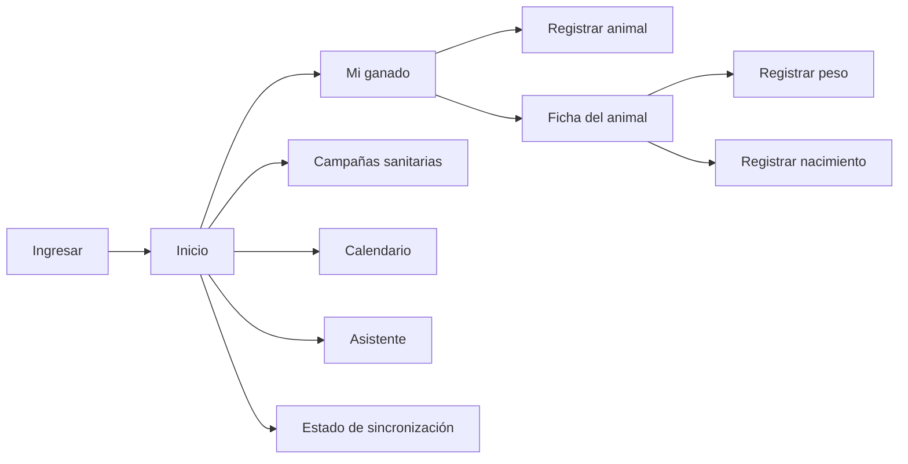

# Interfaces oficiales propuestas — estilo de GanadoConecta

## Identidad visual

- Estilo: limpio, moderno, claro, confianza rural; fondos blanco/marfil, verde profundo para acciones, verde suave para superficies de éxito; gris neutro para datos secundarios.
- UI en **español** y sin jerga innecesaria. Titular del módulo: «Mi ganado», no «Hato».
- Tipografía legible, botones de al menos 44×44 px, buen contraste, mensajes directos; evitar indicadores solo por color.
- **Mobile-first**: navegación inferior o menú compacto; en escritorio, menú lateral. Formularios cortos con secciones opcionales y acción principal siempre visible.
- Barra persistente de conexión: «Sin conexión · 3 registros pendientes», «Sincronizando…», «Todo sincronizado», «Hay conflictos».
- No mostrar datos ficticios como reales; si se utilizan para maquetas, marcarlos «Demostración».

## Mapa de pantallas y rutas sugeridas

| Prioridad | Ruta React sugerida | Pantalla | Principalmente |
|---|---|---|---|
| P0 | `/ingresar` | Iniciar sesión | Todos |
| P0 | `/configurar-ganaderia` | Crear ganadería / primera configuración | Propietario |
| P0 | `/inicio` | Dashboard: ganado activo, próximos controles, pendientes de sincronizar, acceso rápido | Familia autorizada |
| P0 | `/mi-ganado` | Lista, filtros ternera/vaquilla/vaca/ternero/torete/toro, nombre/arete | Familia autorizada |
| P0 | `/mi-ganado/nuevo` | Registro flexible individual | Propietario/editor |
| P0 | `/mi-ganado/:id` | Ficha animal con historial, peso, vacunas, genealogía y foto opcional | Familia autorizada |
| P1 | `/mi-ganado/registro-rapido` | Varias altas con datos compartidos | Propietario/editor |
| P1 | `/mi-ganado/importar` | Importación CSV/Excel (procesamiento definido) | Propietario/editor |
| P1 | `/nacimientos/nuevo` | Parto y registro de una o más crías | Propietario/editor |
| P1 | `/sanidad/campanas` | Actividades generales para todos o seleccionados | Familia autorizada |
| P1 | `/sanidad/campanas/nueva` | Nueva vacunación/baño/desparasitación; confirmar atención individual | Propietario/editor |
| P1 | `/sanidad/controles/nuevo` | Registro sanitario individual | Propietario/editor |
| P1 | `/calendario` | Actividades generales e individuales | Familia autorizada |
| P1 | `/sincronizacion` | Operaciones pendientes/errores/conflictos | Familia autorizada |
| P2 | `/asistente` | Mis animales + información ganadera general con fuentes | Familia autorizada |
| P2 | `/reportes` | Resúmenes sanitarios y pesos | Familia autorizada |
| P2 | `/catalogo` | Catálogo público no transaccional | Todos |
| P2 | `/catalogo/:id` | Ficha pública y genealogía autorizada | Todos |
| P2 | `/mis-anuncios` | Crear, editar y cerrar venta | Propietario |
| P2 | `/familia` | Invitar, modificar y revocar acceso familiar | Propietario |
| P2 | `/administracion` | Usuarios, moderación y estadísticas | Administrador |

P0 = primer flujo funcional; P1 = gestión completa y offline; P2 = IA, catálogo, informes y administración. No construir todas simultáneamente.

## Componentes React reutilizables

`AppShell`, `SidebarDesktop`, `BottomNavMobile`, `SyncStatus`, `OfflineNotice`, `PageHeader`, `MetricCard`, `AnimalCard`, `AnimalCategoryChip`, `AnimalFilter`, `AnimalForm`, `AnimalGenealogyTree`, `SanitaryActivityCard`, `CampaignForm`, `ActivityTimeline`, `WeightChart`, `ReminderCard`, `PublicationCard`, `AIAnswerWithSources`, `ConfirmDialog`, `PermissionGate`, `EmptyState`.

## Wireflow principal en celular

## Pantalla clave — Dashboard

1. Encabezado con ganadería actual, saludo y estado de conexión.
2. Cuatro tarjetas: animales activos, próximos controles, pendientes de atención, operaciones sin sincronizar.
3. Botones grandes: «Registrar animal», «Registrar actividad», «Registrar peso», «Ver calendario».
4. Próximas actividades y accesos a «Mi ganado» y «Asistente».
5. En escritorio, un panel de tendencias con datos reales o «Sin datos suficientes».

## Pantalla clave — Ficha animal

Mostrar `nombre ?? 'Sin nombre'`, UUID/código visible, texto de arete si existe, categoría, sexo, raza y fecha/edad conocida. Pestañas: «Resumen», «Salud y vacunas», «Peso», «Nacimiento y familia», «Actividades». No presentar genealogía incompleta como certificada. Los permisos solo de lectura ocultan acciones de modificación.

## Pantalla clave — Campaña sanitaria

Form rápido: actividad, fecha, todos/selección, animales aplicados/omitidos, siguiente actividad. Sección desplegable «Detalles opcionales»: producto, dosis real, vía, responsable, observaciones, retiro cuando corresponda. Previsualizar «50 seleccionados / 48 atendidos / 2 no atendidos» antes de confirmar. Los menores o animales con precauciones no se consideran aptos automáticamente por el sistema.

## Pantalla clave — Asistente

Dos pestañas o chips visibles: «Mis animales» y «Aprender sobre ganadería». Respuestas sobre cuentas propias incluyen periodo, datos consultados y botón «Ver registros». Respuestas generales incluyen fuentes. Sin fuentes suficientes: «No tengo una fuente verificada para responder con seguridad». Solicitar consulta veterinaria ante signos de enfermedad.

## Principios de accesibilidad y pruebas visuales

Testear 320–390 px (celular), tablet y escritorio; zoom 200 %; manejo con teclado; formularios con etiquetas visibles; mensajes al guardar offline y confirmación real de sincronización; contraste y estados de carga/error/vacío.
