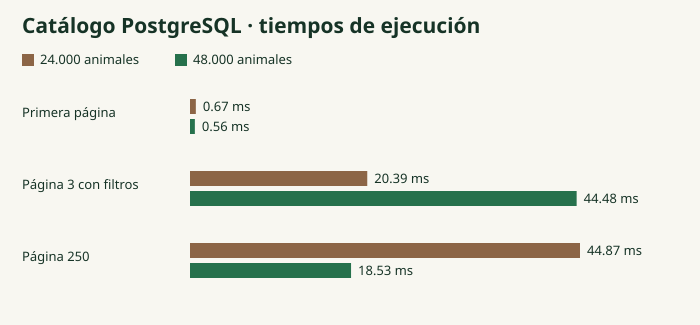

# Cierre de validación del Sprint 2

Base `632c566`, Windows 11 Pro, Intel i5-10400F con 12 CPU lógicas y
16 GiB de RAM. Docker Desktop dispuso de 7,7 GiB. Se conservó la semilla
de 8 ganaderías, 24.000 animales, 12.000 anuncios y 96.000 eventos.
Las parejas de EC01 usaron 100 VU con Redis frío y poblado. La escalada
usó rampas de 5 s y tramos de 16 s, mezcla 50/50 y pausas de 0,85 a
1,45 s. Spring Boot real, PostgreSQL 17.12, Redis 8.4.6 y k6 2.4.0
corrieron en el entorno local aislado. El criterio EC01 conservó p95
≤ 2 s y la escalada conservó el corte operativo de p95 ≥ 4 s y 2 %
de errores. [Arnés](../../../../tests/rendimiento/README.md)

## Primer recorrido de cierre

Con el backend de `632c566`, EC01 volvió a pasar en frío y poblado.
La escalada sostuvo **1.500 VU** durante 16 s y alcanzó **2.000 VU
activos**. El último tramo se interrumpió tras unos 7 s y queda
**fallido**. El p95 alcanzó 5.008,89 ms y 110 de 114 solicitudes
de ese tramo registraron error (96,49 %). Las conexiones establecidas
al muestrear alcanzaron 1.809. La mayor espera apareció antes de
recibir el primer byte. Los p95 de conexión y espera para ese tramo
fueron 0,00 y 5.008,79 ms, respectivamente.

| Modo | p50 ms | p95 ms | p99 ms | p95 animales / catálogo, ms | Req/s | Errores HTTP / comprobaciones |
|---|---:|---:|---:|---:|---:|---:|
| Fría a 100 VU | 15,11 | 46,26 | 511,25 | 47,11 / 42,33 | 84,53 | 0 % / 100 % |
| Poblada a 100 VU | 15,52 | 62,52 | 245,52 | 57,25 / 69,67 | 85,03 | 0 % / 100 % |
| Escalada | 1.433,52 | 4.208,63 | 5.001,36 | — | 200,06 | 2,05 % / 97,95 % |

El tramo completo de 1.500 VU registró p95 de 3.458,07 ms, 378,63
solicitudes por segundo y 0,02 % de errores. El umbral EC01 se aplica
a 100 VU. El corte operativo de la escalada tiene su propio límite.

El primer intento de muestreo JMX careció del MBean Hikari. Las
mediciones de cliente, PostgreSQL, Redis y TCP de ese recorrido siguen
disponibles. Al revisar la configuración se confirmó que el adaptador
creaba un pool con **máximo de 3 conexiones** y 3.000 ms de espera.
Las variables de 10 máximas y 4 inactivas del lanzador anterior no se
aplicaban al adaptador. Se conserva el resultado histórico y se corrige
la descripción de la configuración efectiva.

[Resumen del primer recorrido](cierre-resumen.json) ·
[Muestras TCP y recursos](cierre-progresiva-recursos.csv)

## Diagnóstico con métricas de servidor

Se habilitó JMX local en el arnés. La segunda corrida confirmó el
agotamiento del pool y la cola de trabajo HTTP. A partir de 500 VU se
observaron **200 de 200 hilos Tomcat ocupados** y hasta **197 solicitudes
esperando una conexión**, con las **3 de 3 conexiones Hikari activas**.
La media de tiempo procesado por Tomcat en ese tramo fue 501,95 ms y
el p95 de espera del primer byte desde k6, 1.524,75 ms. A 1.000 VU
se reprodujo la saturación de ambos recursos. La etapa de 1.500 VU
interrumpió esta corrida con p95 de 4.914,49 ms y 4,69 % de errores.

- **TCP.** Tomcat registró hasta 1.501 conexiones con un límite de
  8.192. El valor 100 de `acceptCount` es configuración del backlog.
  El contador de ocupación de esa cola no estuvo disponible.
- **JVM y carga.** Se observaron 247,68 MiB de heap, 664 MiB RSS de
  Java, 273 ms acumulados de GC en la ventana de la escalada y
  1.016 MiB RSS de k6. Java y k6 registraron picos muestreados de
  23 % y 186 % de una CPU. Esto localiza espera y deja abierta la
  contribución de la contención de procesos en Windows.
- **PostgreSQL y Redis.** PostgreSQL tuvo hasta dos procesos activos
  en una muestra y no reportó esperas de bloqueo ni de E/S en
  esos puntos. Redis entregó 12.225 aciertos y 109 ausencias.
  La media de ejecución de `GET` fue 7,29 µs según Redis.
  La saturación comprobada fue de admisión en la aplicación.
  Las muestras no establecen la causa de cada ocupación de conexión.

[Resumen instrumentado](cierre-instrumentado-resumen.json) ·
[JMX original](cierre-instrumentado-jmx.csv) ·
[Escalada comparada](comparacion-escalada.svg)

## Comparación acotada de Hikari

Se hizo configurable el tamaño del pool conservando el valor
predeterminado de tres conexiones y el plazo original de 3.000 ms.
El cambio habilitó un ensayo de cinco conexiones. No modifica la
autorización, el código de negocio, los hilos HTTP ni la caché.

La escalada con cinco conexiones se detuvo por memoria al entrar al
tramo de 250 VU. El monitor observó 1.387 MiB disponibles frente al
mínimo de 1.536 MiB. Los dos ensayos EC01 de esa serie sí terminaron,
con p95 global de 45,98 ms en frío y 56,55 ms con caché poblada,
cero errores y 100 % de comprobaciones.

Se repitió una comparación acotada con la misma semilla, JVM, mezcla
y precarga, iniciando cada Java por separado. Cada variante ascendió
en 5 s y sostuvo 500 VU durante 25 s.

| Pool | p50 / p95 / p99 del tramo, ms | Req/s | Errores | Hikari esperando máx. | Hilos Tomcat ocupados máx. |
|---|---:|---:|---:|---:|---:|
| 3 conexiones | 600,80 / 1.947,20 / 2.692,23 | 257,36 | 0 % | 197 | 200 |
| 5 conexiones | 556,75 / 2.293,52 / 3.036,23 | 251,76 | 0,10 % | 195 | 200 |

Cinco conexiones redujeron la mediana en esta muestra, con peor p95
y caudal. Las dos variantes alcanzaron el límite de hilos. La
comparación no justifica elevar el valor predeterminado. Se conservan
las trazas y se recomienda separar el generador en otro equipo del
laboratorio, repetir los tramos con margen de memoria e instrumentar
los tiempos de adquisición y retención de conexión por operación antes
de ajustar recursos de forma definitiva.

[Pool 3 a 500 VU](cierre-ab3-resumen.json) ·
[Pool 5 a 500 VU](cierre-ab5-resumen.json) ·
[Serie de cinco conexiones detenida por memoria](cierre-pool5-resumen.json)

## Crecimiento del volumen SQL

Se clonó la base sintética y se duplicó el volumen en la copia a
48.000 animales, 24.000 anuncios y 192.000 eventos. Se alternaron tres
pares de planes con el mismo SQL, mismos filtros, misma estación y
estadísticas actualizadas. El listado por cursor mantuvo 0,10 ms de
mediana y 7 bloques compartidos. El catálogo filtrado pasó de 20,39 a
44,48 ms y el reporte mensual de 2,48 a 6,52 ms. La página 250 pasó
de 44,87 a 18,53 ms al cambiar el plan de escaneos secuenciales y orden
por un recorrido de `ix_anuncio_publico_orden` de 5.001 filas. El
resultado depende del plan y la distribución sintética.

[Planes SQL originales](crecimiento-planes.json) ·
[Resumen de tiempos y buffers](crecimiento-resumen.json)

## Escenarios de calidad en el cierre

| Escenario | Verificación ejecutada | Alcance pendiente |
|---|---|---|
| EC02 | Alta HTTP 201 y ficha, historial y catálogo HTTP 200 con Redis detenido. Una prueba Java repitió alta, historial y catálogo tras detener el motor HTTP local de IA. [Resultados Redis](continuidad-redis.json). | Continuidad y reintentos con el proveedor externo de notificaciones. |
| EC06 | Cinco pruebas del núcleo de publicación con dobles y sin servicios. La comprobación `jdeps` verificó la dirección de las dependencias. | Métricas adicionales de esfuerzo para futuras modificaciones. |
| EC07 | Spring Boot rechazó cuatro respuestas inválidas de IA y la caída del motor con HTTP 503. Se verificó que el aviso omita credenciales y que el historial persista. | Pruebas con el proveedor externo de notificaciones una vez integrado. |
| EC08 | Chrome headless sobre HTTPS, Spring Boot y PostgreSQL aislados. Los cuatro recorridos aprobaron, incluida la navegación privada, el foco por teclado y la búsqueda anónima a 360, 768 y 1440 px. [Resultados](chrome-recorridos.json). | Evaluación con personas, dispositivos físicos y lector de pantalla. |
| EC12 | Tres pasos aprobados en Chrome, incluida la revocación de un editor con un alta pendiente en IndexedDB. Al reconectar, «Sincronizar pendientes» informó el cambio de permisos y no intentó el alta. El reenvío directo del payload original recibió HTTP 403. Se comprobó ausencia del alta remota y conservación local. El arnés preparó la membresía sintética mediante la API real. [Resultados](chrome-revocacion.json). | Validar conflictos de edición cuando exista ese flujo versionado. |

Pasaron 22 pruebas Java dirigidas de arquitectura, publicación,
catálogo, Redis, JDBC y asistente. El primer grupo tuvo un fallo en
la aserción del texto del log por codificación. Se ajustó la aserción
y el caso pasó en una repetición individual. Las dos pruebas JDBC
también pasaron tras el cambio de configuración de Hikari. Pasaron
7 pruebas Python y 36 pruebas Vitest de autorización y persistencia
offline. Los resultados completos anteriores de Java y GitHub Actions
corresponden a la [base publicada](../../README.md#integración-continua-remota).

[Captura sintética del catálogo a 360 px](ux-360-catalogo.png) ·
[Captura sintética de la ficha a 1440 px](ux-1440-ficha.png) ·
[Matriz EC01–EC13](../../matriz-calidad.md)
