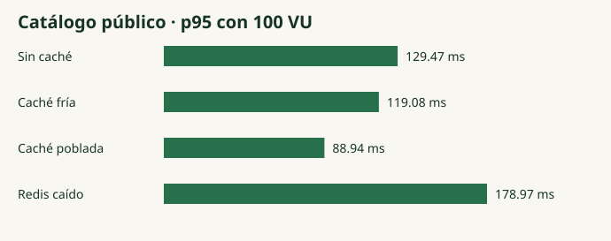
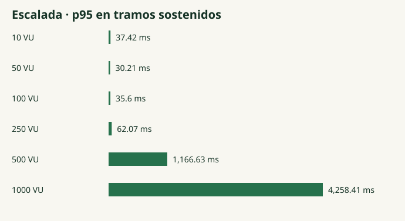

# Carga REST con k6

k6 2.4.0 para Windows con SHA-256 verificado. Se usó Spring Boot 3.5.16
con Java 22.0.1, PostgreSQL 17.12 y Redis 8.4.6. El backend escuchó en
loopback y usó el mismo jar en las cuatro comparaciones, con
`-Xms256m -Xmx768m -XX:ActiveProcessorCount=4`. La revisión de cierre
confirmó que el adaptador usaba tres conexiones Hikari efectivas pese a
las variables del lanzador original. PostgreSQL tuvo un
límite de 2 CPU y 768 MiB. Redis tuvo 1 CPU, límite de contenedor de
160 MiB, límite interno de 96 MiB y TTL de 30 s. El generador y la API
compartieron la estación Windows 11 Pro de 12 CPU lógicas y 16 GiB de RAM.

Se usó la misma semilla UUIDv4 de ocho cuentas, 24.000 animales,
12.000 anuncios y 96.000 eventos. Cada VU alternó lectura autenticada
de animales (50 %) y catálogo (50 %) con pausas de 0,85 a 1,45 s.
Se verificaron pertenencia, paginación, filtros, unicidad y proyección
pública. Se excluyeron Ollama y la transferencia de fotos.
[Preparación y condiciones reproducibles](../../../tests/rendimiento/README.md)

## EC01 y comparación con 100 VU

El smoke de 2 VU y los calentamientos de 20 VU pasaron. Cada comparación
sostuvo 100 VU durante 25 segundos. Con caché fría se partió de Redis
vacío con la JVM caliente. Con caché poblada se confirmaron 12 claves antes
de iniciar. La caída se probó con el servicio Redis detenido y Spring
configurado para usarlo. Todos los tramos obtuvieron 100 % de comprobaciones
funcionales y 0 % de errores HTTP.

| Modo | p50 ms | p95 ms | p99 ms | req/s | p95 animales ms | p95 catálogo ms | Aciertos Redis catálogo |
|---|---:|---:|---:|---:|---:|---:|---:|
| Sin caché | 18,15 | 170,18 | 361,50 | 83,60 | 235,56 | 129,47 | — |
| Caché fría | 14,67 | 135,00 | 406,19 | 84,24 | 175,92 | 119,08 | 1.088/1.114 (97,67 %) |
| Caché poblada | 15,92 | 102,70 | 210,83 | 85,16 | 116,75 | 88,94 | 1.119/1.119 (100 %) |
| Redis caído | 18,35 | 153,75 | 302,01 | 83,60 | 136,74 | 178,97 | — |

EC01 pasó en sus dos condiciones aprobadas. El p95 del catálogo con
caché poblada fue 31,3 % menor que en el tramo sin caché. El caudal cambió
poco porque el guion conserva las pausas de usuario. En frío, el p99
global aumentó respecto de la línea base. Son mediciones individuales
en una estación compartida y no incluyen un intervalo de confianza.
Los aciertos Redis representaron 48,8 % y 50,0 % del total de solicitudes
en las dos pruebas con caché, respectivamente.

| Modo | CPU Java / k6 / PostgreSQL | RSS Java / k6 | Memoria PostgreSQL / Redis | PostgreSQL, conexiones/activas máximas |
|---|---:|---:|---:|---:|
| Sin caché | 119 / 27 / 88 % | 470 / 84 MiB | 193,7 / 7,3 MiB | 3 / 0 |
| Caché fría | 121 / 31 / 13 % | 588 / 85 MiB | 188,3 / 7,1 MiB | 3 / 1 |
| Caché poblada | 70 / 33 / 14 % | 515 / 84 MiB | 188,8 / 7,5 MiB | 3 / 0 |
| Redis caído | 51 / 21 / 94 % | 520 / 85 MiB | 197 / — MiB | 3 / 2 |

Los máximos son de muestras, no de todas las solicitudes. Un 100 % de CPU
equivale a un núcleo lógico. Las conexiones activas se observaron en
instantes discretos vía `pg_stat_activity`. Los contadores Redis se
obtuvieron de `INFO stats`. El primer smoke se detuvo por memoria.
Una versión preliminar de la semilla provocó HTTP 422 al usar UUID que
no eran v4. Se aisló y se corrigió esa semilla antes de medir.

## Escalada solicitada hasta 2.000 VU

k6 alcanzó **1.000 VU activos** y detuvo ese tramo por su límite operativo
de p95 de 4 s. El mayor tramo sostenido completo fue **500 VU**. No se
ejecutaron los tramos de 1.500 ni 2.000 VU. El agregado de la escalada
registró 17.505 solicitudes, 143,26 req/s, p95 de 3.410,60 ms y 0,07 %
de errores HTTP.

| VU | Tramo sostenido observado | p50 ms | p95 ms | p99 ms | req/s aprox. | Errores |
|---|---:|---:|---:|---:|---:|---:|
| 10 | 16 s | 13,12 | 37,42 | 85,83 | 9,44 | 0 % |
| 50 | 16 s | 13,88 | 30,21 | 70,31 | 44,38 | 0 % |
| 100 | 16 s | 13,92 | 35,60 | 97,30 | 87,56 | 0 % |
| 250 | 16 s | 15,79 | 62,07 | 109,99 | 217,81 | 0 % |
| 500 | 16 s | 356,61 | 1.166,63 | 1.608,00 | 313,56 | 0 % |
| 1.000 | 12,19 s hasta el corte | 2.829,14 | 4.258,41 | 4.740,27 | 169,94 | 0,58 % |

El cuello observado fue la espera del primer byte. El p95 agregado de
`http_req_waiting` fue de 3.405,52 ms, frente a 1,34 ms en conexión
y 10,77 ms en recepción. Redis registró 8.442 aciertos y 111 ausencias.
Las muestras alcanzaron 18 % de una CPU y 538 MiB RSS en Java, 102 %
y 800 MiB en k6, y 75 % de una CPU y 195 MiB en PostgreSQL.
PostgreSQL mostró hasta 3 conexiones y 2 activas en una muestra.
Redis llegó a 10,81 % de CPU y 10,52 MiB. Windows llegó a un mínimo de
1.665 MiB disponibles. El muestreo no mostró agotamiento sostenido de CPU
ni del pool. La espera incluye el servidor y el transporte local, por lo
que estas muestras no permiten atribuirla a una cola concreta. Para
localizarla conviene medir la cola de Tomcat y los tiempos del pool en
el mismo intervalo y separar el generador de la estación del backend.

El límite operativo de 4 s protege esta prueba de escalada. EC01 conserva
su umbral de 2 s a 100 VU. El resultado no certifica capacidad productiva,
alta disponibilidad ni 2.000 usuarios concurrentes.

[Resumen calculado](k6-resumen.json) · [Salida original de la escalada](k6-progresiva.json) ·
[Muestras de recursos de la escalada](recursos-progresiva.csv)

Salidas originales a 100 VU. [Sin caché](k6-cien-sin-cache.json) ·
[Fría](k6-cien-cache-fria.json) · [Poblada](k6-cien-cache-poblada.json) ·
[Redis caído](k6-cien-redis-caido.json)
