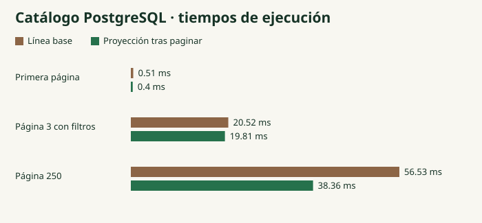

# Análisis de PostgreSQL

Medición del 27 de noviembre de 2026 en PostgreSQL 17.12 para Windows 11 Pro
con Docker Desktop. El Compose aislado asignó dos CPU lógicas y 768 MiB al
contenedor. El equipo tiene un Intel Core i5-10400F, 12 CPU lógicas,
16 GiB de RAM y una RTX 2060. Docker dispuso de aproximadamente 7,7 GiB.
Las consultas no usan GPU.

La semilla reproducible creó ocho cuentas y ganaderías sintéticas, 24.000
animales, 12.000 anuncios y 96.000 eventos sanitarios. Se ejecutó
`ANALYZE` antes de comparar. La semilla no incluye fotografías,
parentescos ni series de peso, por lo que los planes de esas ramas no
representan poblaciones densas. Las consultas de reportes son diagnósticas y
quedan fuera del criterio EC01.

## Comparación de planes

Tres pares alternados de `EXPLAIN (ANALYZE, BUFFERS, FORMAT JSON)` sobre
el mismo conjunto de datos. Los tiempos son medianas en milisegundos.
Se ejecutaron las consultas de lectura del código de `ea72e80` y las del
adaptador actualizado. Los conteos de buffers son bloques compartidos.

| Consulta | Planificación inicial / final | Ejecución inicial / final | Bloques en memoria inicial / final |
|---|---:|---:|---:|
| Primera página de animales | 0,129 / 0,106 | 0,057 / 0,034 | 7 / 7 |
| Animales con cursor | 0,106 / 0,103 | 0,074 / 0,076 | 7 / 7 |
| Catálogo, primera página | 5,412 / 1,528 | 0,509 / 0,398 | 91 / 91 |
| Catálogo, página 3 y filtros | 4,271 / 1,533 | 20,516 / 19,805 | 14.712 / 14.712 |
| Catálogo, página 250 | 5,253 / 1,109 | 56,527 / 38,357 | 719 / 719 |
| Reporte sanitario de un mes | 1,405 / 1,096 | 2,895 / 2,419 | 374 / 374 |

Las mediciones de animales y reportes son controles. Sus consultas no
cambiaron. Las diferencias entre muestras reflejan variación de la ejecución.

- El listado y el cursor usan `ix_animal_ganaderia_listado` y devuelven
  hasta 21 filas para determinar el cursor siguiente. El catálogo inicial
  usa `ix_anuncio_publico_orden`. Estos planes no justifican índices adicionales.
- El filtro usa un bitmap de `ix_anuncio_publico_ubicacion`, examina 4.816
  anuncios después del filtro de precio y consulta el animal asociado. En
  el plan de catálogo profundo, PostgreSQL leyó secuencialmente 24.000
  animales y 12.000 anuncios. Los planes no registraron lecturas físicas en
  estas medianas con buffers calientes.
- La proyección de fotos pasó de 1.216 a 21 ejecuciones del subplan en la
  página filtrada y de 12.000 a 21 en la profunda. `AnunciosPostgres`
  pagina primero y después consulta las referencias de fotos y genealogía
  de la página. Ambas consultas se ejecutan en una sola sentencia JDBC. No
  se observó un N+1 de llamadas JDBC a fotos en estos listados.
- El reporte mensual agregó 955 eventos sanitarios en el plan examinado.
  El índice existente aporta el filtro por ganadería. El volumen y la
  forma de consultas probados no justifican otro índice todavía.

La mediana de la página 250 bajó 32,1 % en este dataset. La diferencia
de la página filtrada fue mucho menor. Estas cifras miden ejecución
SQL. Quedan fuera la autorización, el pool, la serialización y la red.

[Planes originales estructurados](postgres-planes.json) ·
[Resumen de tiempos y buffers](postgres-resumen.json) ·
[Comandos y dataset](../../../tests/rendimiento/README.md)
